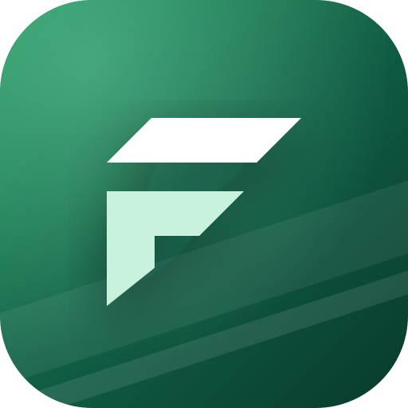
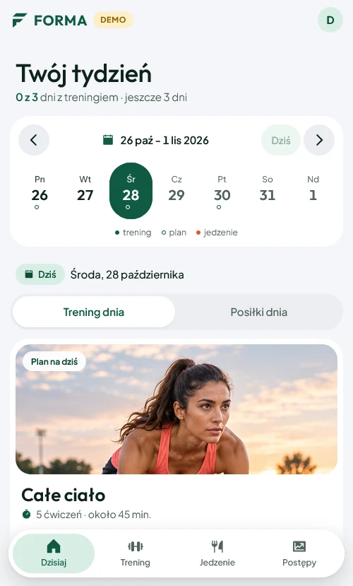
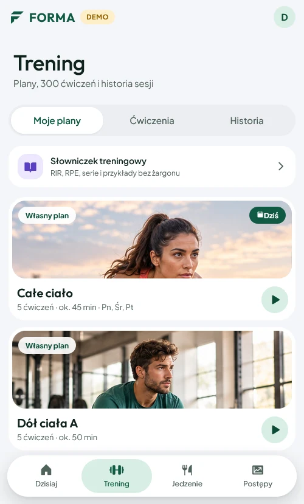
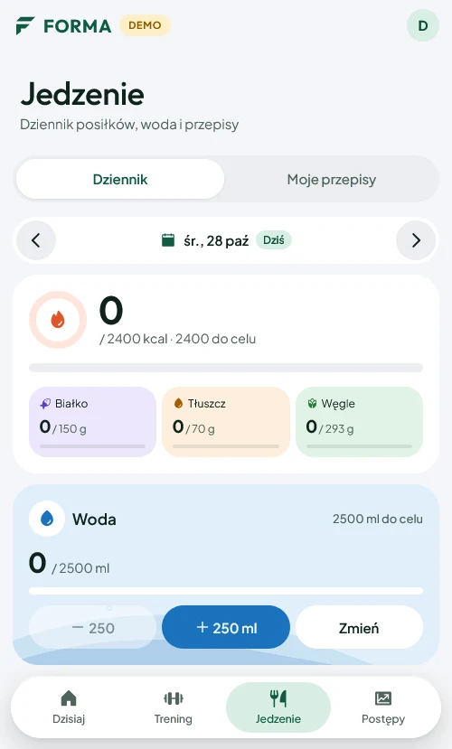
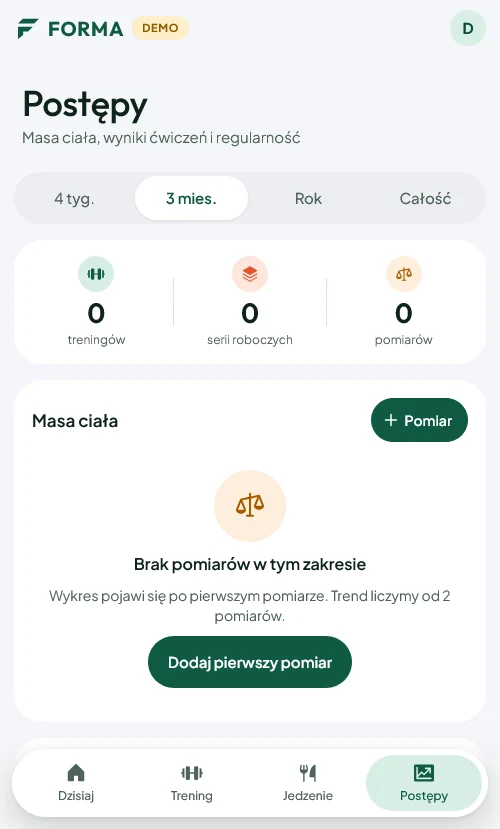

<div align="center">



# FORMA

**Dziennik treningu i jedzenia na Androida. Działa bez internetu.**


[](LICENSE)

[**Pobierz APK**](https://forma-mobi-2026-4e7c1a.web.app/) · [Funkcje](#funkcje) · [Bezpieczeństwo i prywatność](#bezpieczeństwo-i-prywatność) · [Uruchomienie](#uruchomienie)

</div>

<br>

<table>
  <tr>
    <td></td>
    <td></td>
    <td></td>
    <td></td>
  </tr>
  <tr>
    <td align="center"><b>Dzisiaj</b><br><sub>tydzień, trening i posiłki dnia</sub></td>
    <td align="center"><b>Trening</b><br><sub>plany, 300 ćwiczeń, historia</sub></td>
    <td align="center"><b>Jedzenie</b><br><sub>kalorie, makro i woda</sub></td>
    <td align="center"><b>Postępy</b><br><sub>masa ciała, wyniki, regularność</sub></td>
  </tr>
</table>

## Czym jest FORMA

FORMA to osobisty dziennik na siłownię i do kuchni w jednej aplikacji. Zapisujesz serie w trakcie treningu, liczysz kalorie i makro, a potem widzisz postępy. Dane leżą na telefonie, więc wszystko działa także na siłowni bez zasięgu.

## Funkcje

**Trening**
- Plany z dniami, kolejnością ćwiczeń, seriami, powtórzeniami, przerwami i RIR. Można też trenować bez planu.
- Każda ukończona seria zapisuje się od razu. Widać poprzednie wyniki, jest timer przerwy, pauza, cofanie, pomijanie i zamienniki.
- Biblioteka 300 ćwiczeń z polskimi instrukcjami i zdjęciami pozycji offline, filtry (cardio, siła, na początek, bez podskoków).
- Ekran nie gaśnie w trakcie treningu, powiadomienie z końcem przerwy i wibracje.

**Jedzenie**
- Produkty z Open Food Facts sprzedawane w Polsce i baza USDA, wyszukiwanie bez polskich znaków.
- Skaner kodów kreskowych (EAN-13, EAN-8, UPC-A), porcje z etykiety, ulubione i własne produkty.
- Przepisy z masą po przygotowaniu, planowane i zjedzone posiłki, kopiowanie dnia, woda.
- Nieznane makro zostaje nieznane, zamiast udawać zero.

**Postępy i nawyki**
- Masa ciała z trendem, historia siły według miejsca i sprzętu, sugestie progresji.
- Serie dni z kalendarzem i rekordem, widżety na ekran główny w stylu One UI.
- Kalkulatory: zapotrzebowanie (Mifflin-St Jeor), makro, energia porcji po gotowaniu, talerze na sztangę.

**Dane**
- Eksport i import kopii JSON (z własnymi filmami), CSV do arkusza z ochroną przed formułami.
- Opcjonalne konto i ręczne prywatne kopie w Firestore (serwery w Warszawie).
- Aktualizacje w aplikacji z kontrolą sumy SHA-256 pobranego APK.

## Bezpieczeństwo i prywatność

- **Dane zostają na telefonie** (IndexedDB w aplikacji). Konto w chmurze jest opcjonalne.
- **Reguły Firestore** wpuszczają tylko właściciela z potwierdzonym e-mailem, sprawdzają schemat każdej kopii, rozmiar rekordów i limity zapytań ([`firebase/firestore.rules`](firebase/firestore.rules), testy w [`firebase/rules.test.mjs`](firebase/rules.test.mjs)).
- **Kopia jest niezmienna**: można ją tylko dokończyć albo usunąć, a przywracanie sprawdza dane przed nadpisaniem telefonu.
- **Rozpoznawanie posiłku ze zdjęcia** działa tylko dla konta właściciela, z dziennym limitem i odstępem między zapytaniami ([`functions/index.js`](functions/index.js)).
- **Android**: wyłączona kopia w chmurze Google (`allowBackup=false`), zakaz ruchu bez HTTPS, wyłączone debugowanie WebView.
- **Strona w WebView** ma politykę CSP z listą dozwolonych adresów.
- Klucze podpisu APK i konfiguracja Firebase (`.env.local`) nie są częścią repozytorium.

## Uruchomienie

Potrzebne: Node.js 20+, a do APK także JDK 17 i Android SDK.

```bash
npm ci
cp .env.example .env.local   # konfiguracja własnego projektu Firebase (opcjonalnie)
npm run dev                  # podgląd w przeglądarce
npm test                     # testy (Vitest)
npm run build                # wersja produkcyjna w dist/
npx cap sync android         # kopiuje dist/ do projektu Androida
```

APK buduje skrypt [`scripts/build-android.ps1`](scripts/build-android.ps1). Bez konfiguracji Firebase aplikacja działa w pełni lokalnie.

## Technologie

| Warstwa | Co |
|---|---|
| Interfejs | React 19, TypeScript, Vite, PWA |
| Android | Capacitor 7 (WebView), natywne widżety i powiadomienia, ML Kit do kodów kreskowych |
| Dane | IndexedDB (`idb`), eksport JSON i CSV |
| Chmura | Firebase Auth, Firestore, Cloud Functions (Warszawa) |
| Testy | Vitest, emulator reguł Firestore |

## Źródła danych

- Produkty: © [Open Food Facts](https://world.openfoodfacts.org) contributors, baza na licencji [ODbL 1.0](https://opendatacommons.org/licenses/odbl/1-0/), zawartość rekordów na licencji Database Contents License (`public/data/foods-pl-odbl.json`).
- Produkty i potrawy: [USDA FoodData Central](https://fdc.nal.usda.gov/) (domena publiczna / CC0).
- Zdjęcia pozycji ćwiczeń: [free-exercise-db](https://github.com/yuhonas/free-exercise-db) (Unlicense).
- Filmy instruktażowe to linki do oryginalnych publikacji w YouTube (`src/data/exercise-videos.json`).

Licencja MIT dotyczy kodu aplikacji. Dane z powyższych źródeł zachowują swoje licencje.

## Licencja

[MIT](LICENSE) © 2026 [xwolter](https://github.com/xwolter)
